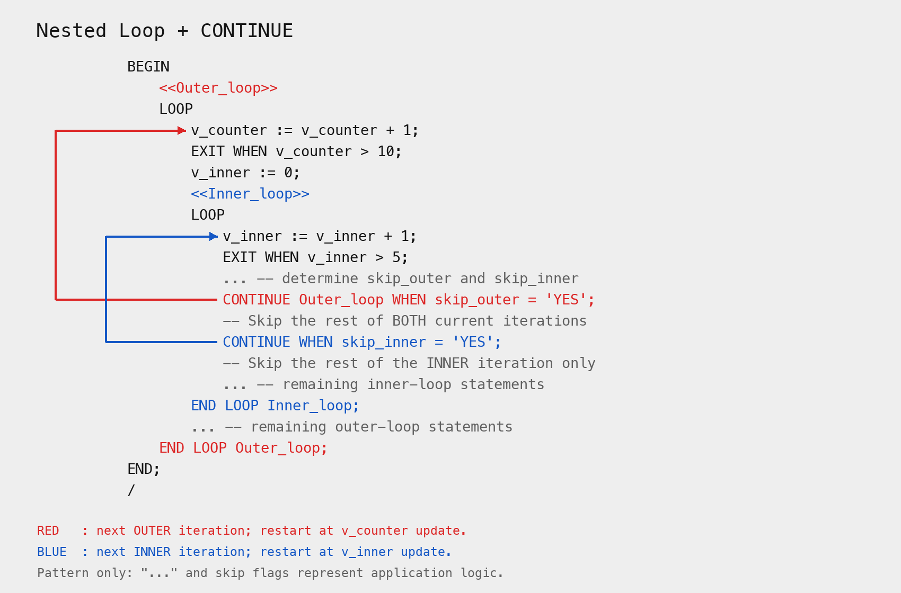
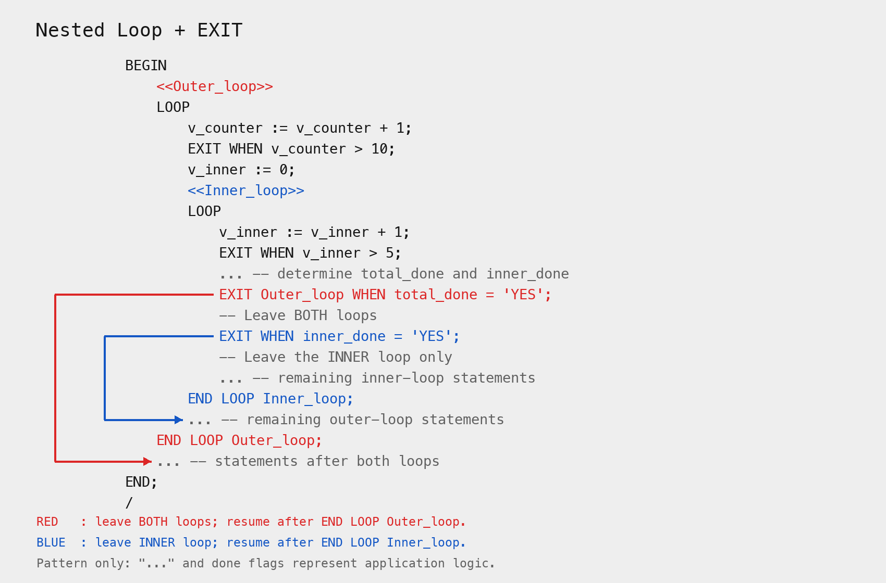

# 巢狀迴圈內使用 Continue 及 Exit 控制迴圈流程 (P06_01)

## 使用 Continue 繼續下一次迴圈

- 使用 Continue 跳過迴圈中剩下的敘述，直接進入下一次迴圈。
- Continue label_name; 會跳到指定的迴圈標籤，並開始下一次迴圈，用於跳躍多層巢狀迴圈時。

## 使用 Exit 離開迴圈

- 使用 Exit 離開迴圈，並結束迴圈的執行。
- Exit label_name; 會跳到指定的迴圈標籤，並結束該迴圈的執行，用於跳躍多層巢狀迴圈時。

